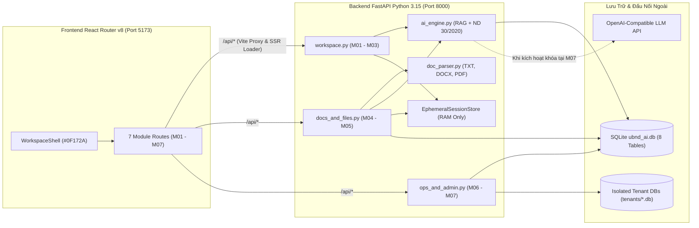

# Báo Cáo Tổng Hợp Mã Nguồn — Bộ Trợ Lý AI UBND Xã, Phường

Tài liệu này tổng hợp kiến trúc kỹ thuật, tổ chức mã nguồn, danh mục **27 REST API endpoints**, thiết kế cơ sở dữ liệu, cơ chế an toàn thông tin và kết quả kiểm thử của toàn bộ dự án dựa trên hồ sơ nghiệp vụ gốc `Profile_gioi_thieu_Bo_Tro_ly_AI_UBND_xa_phuong_TSH.pdf`.

> [!IMPORTANT]
> Hệ thống tuân thủ xuyên suốt nguyên tắc pháp lý cốt lõi: *"AI là công cụ hỗ trợ nghiệp vụ; cán bộ, công chức và người có thẩm quyền vẫn trực tiếp kiểm tra, quyết định và chịu trách nhiệm đối với nội dung sử dụng."* Toàn bộ dữ liệu tệp tải lên trong phiên làm việc chỉ nằm trên RAM và bị hủy tức thì khi kết thúc phiên.

---

## 1. Số Liệu Tổng Quan Mã Nguồn (Codebase Metrics)

| Hạng mục | Thống kê thực tế | Công nghệ / Ghi chú |
| :--- | :--- | :--- |
| **Backend (`backend/`)** | `3.142` dòng lệnh Python (`18` tệp) | Python `3.15.2`, FastAPI `0.163`, Pydantic `2.14`, `sqlite3`, `httpx` |
| **Frontend Nghiệp vụ (`app/app/`)** | `5.125` dòng TypeScript/TSX (`26` tệp code & test riêng) | React `19.3`, React Router `8.5` (Framework Mode SSR), Vite `8`, Tailwind CSS `4.2` |
| **Thư viện UI (`components/ui/`)** | `64` thành phần giao diện | `63` thành phần gốc `shadcn/ui` + `formatted-markdown.tsx` |
| **Tổng số REST Endpoints** | `27` endpoints dưới tiền tố `/api/*` | Chia thành 3 router nghiệp vụ + nhóm kiểm tra kết nối |
| **Tầng Lưu trữ** | `8` bảng SQLite bền vững + `1` RAM Store | Tách biệt dữ liệu quản lý lâu dài và tài liệu tạm trong phiên |
| **Kiểm thử Tự động & E2E** | `33/33` bài test đạt (`20` Backend + `13` Frontend) | Kèm kiểm thử tương tác trực tiếp trên Chrome (`0` lỗi console) |

---

## 2. Kiến Trúc Tổng Thể & Luồng Dữ Liệu



---

## 3. Bản Đồ Tổ Chức Thư Mục & Trách Nhiệm Từng Tệp

### 3.1. Dịch vụ Backend (`backend/`)
- `backend/main.py` (`68` dòng): Khởi tạo FastAPI `lifespan` tự động dựng CSDL, cấu hình CORS, `/api/health`, `/api/hello` và gắn 3 router chính.
- `backend/db.py` (`511` dòng): Định nghĩa schema 8 bảng SQLite, nạp dữ liệu mẫu cho 4 phòng (`VP`, `KT`, `VHXH`, `NNMT`), kiểm tra quyền kho riêng `can_access_private_docs()`, ghi vết `log_audit()` và quản lý `EphemeralSessionStore` trên RAM.
- `backend/schemas.py` (`107` dòng): Khai báo kiểu `Literal` và ràng buộc dữ liệu đầu vào Pydantic v2 cho toàn bộ 7 mô-đun.
- `backend/services/doc_parser.py` (`129` dòng): Đọc an toàn `.txt`, `.md`, `.csv`, `.json`, `.docx`, `.pdf` (kèm thông báo fallback rõ ràng cho PDF bản quét hình ảnh), giới hạn cứng `10 MB`/tệp.
- `backend/services/ai_engine.py` (`684` dòng): Tìm kiếm văn bản có cách ly theo phòng ban, xử lý hội thoại 3 chế độ (M01), phân tích 3 phương án (M02), sinh dự thảo chuẩn Nghị định `30/2020/NĐ-CP` & chấm điểm 5 tiêu chí (M03), xử lý 4 tác vụ hồ sơ phiên (M05) và kết nối HTTP LLM.
- `backend/routers/workspace.py` (`152` dòng), `backend/routers/docs_and_files.py` (`249` dòng), `backend/routers/ops_and_admin.py` (`445` dòng): Toàn bộ 27 REST API endpoints cho 7 mô-đun.

### 3.2. Ứng dụng Frontend (`app/`)
- `app/app/routes.ts` & `app/app/routes/workspace-layout.tsx`: Định tuyến lồng nhau đồng bộ trạng thái phòng ban qua URL `?dept=`.
- `app/app/components/layout/workspace-shell.tsx` (`434` dòng): Thanh điều hướng tối `#0F172A` (`268px`) chứa bộ chọn 4 không gian làm việc, 12 liên kết điều hướng chuẩn TSH, công cụ chuyển nhanh vai trò kiểm thử RBAC và chân trang pháp lý.
- `app/app/lib/api.ts` (`344` dòng) & `app/app/lib/session.ts` (`83` dòng): Typed HTTP client đính kèm `X-Actor-Email`, tải tệp multipart và xoay mã phiên mới ngay khi xóa bộ nhớ.
- `app/app/routes/m01-assistant.tsx` .. `m07-admin.tsx`: Giao diện tương tác cho toàn bộ 7 mô-đun nghiệp vụ và quản trị.

---

## 4. Danh Mục 27 Điểm Cuối REST API (`/api/*`)

| Phân hệ | Phương thức & Đường dẫn | Mục đích & Cơ chế bảo vệ |
| :--- | :--- | :--- |
| **Hệ thống & Phiên** | `GET /api/health`, `GET /api/hello` | Kiểm tra trạng thái sống & kết nối mẫu FE ↔ BE |
| **Hệ thống & Phiên** | `GET /api/departments` | Trả về 4 không gian phòng ban và `instruction` hiện hành |
| **Hệ thống & Phiên** | `GET / DELETE /api/sessions/{session_id}` | Đọc trạng thái phiên tạm hoặc **xóa trắng 100% RAM phiên** |
| **Mô-đun 01** | `POST /api/m01/chat` | Hỏi đáp 3 chế độ (`soan_thao`, `nghiep_vu`, `tham_dinh`) có kiểm tra quyền `kho_rieng` |
| **Mô-đun 02** | `POST /api/m02/analyze` | Phân tích 3 phương án độc lập (`Phương án A, B, C`) ngoài kho nội bộ |
| **Mô-đun 03** | `POST /api/m03/draft`, `POST /api/m03/audit` | Sinh dự thảo chuẩn Nghị định `30/2020/NĐ-CP` & chấm điểm 5 tiêu chí (`/100`) |
| **Mô-đun 04** | `GET / POST /api/m04/documents` | Tra cứu & thêm văn bản (chặn `403` nếu ghi trái phòng hoặc không phải `owner` với văn bản chung) |
| **Mô-đun 04** | `GET / POST /api/m04/update-requests` | Danh sách & gửi đề nghị cập nhật văn bản mới |
| **Mô-đun 05** | `POST /api/m05/sessions/{session_id}/upload` | Tải tệp phiên (đọc giới hạn luồng `10 MB + 1B`, chặn `.exe` `400`, quá cỡ `413`) |
| **Mô-đun 05** | `POST /api/m05/sessions/{session_id}/process` | Chạy 4 tác vụ: `tom_tat`, `trich_xuat`, `doi_chieu`, `tong_hop` |
| **Mô-đun 06** | `GET / POST /api/m06/tasks`, `PATCH /api/m06/tasks/{task_id}` | Tổng hợp 4 KPI, giao nhiệm vụ, cập nhật `%` tiến độ & tăng bộ đếm nhắc việc |
| **Mô-đun 07** | `GET / POST /api/m07/users`, `DELETE /api/m07/users/{user_id}` | Quản lý phân quyền email (bắt buộc `owner`, thiếu header trả `403`, chống xóa `owner` cuối cùng) |
| **Mô-đun 07** | `PUT /api/m07/departments/{dept_id}/instruction` | Cập nhật chỉ dẫn AI riêng cho từng phòng (`owner` only) |
| **Mô-đun 07** | `GET /api/m07/api-connectors`, `PUT /api/m07/api-connectors/{id}` | Xem/lưu cổng LLM; luôn ẩn `api_key` gốc thành `***` |
| **Mô-đun 07** | `GET /api/m07/audit-logs` | Truy xuất nhật ký hoạt động xuyên suốt M01–M07 |
| **Mô-đun 07** | `GET /api/m07/tenants`, `POST /api/m07/clone-tenant` | Nhân bản CSDL độc lập cho xã/phường mới (chuẩn hóa slug `[a-z0-9-]+`, trùng trả `409`) |

---

## 5. Lệnh Kiểm Chứng & Vận Hành

```bash
# 1. Chạy toàn bộ 20 bài kiểm thử Backend
cd /home/fedora/Documents/UBND-AI-Support
.venv/bin/python -m unittest discover -s backend/tests -v

# 2. Chạy toàn bộ 13 bài kiểm thử Frontend + Typecheck + Build SSR/Client
cd /home/fedora/Documents/UBND-AI-Support/app
npm test && npm run typecheck && npm run build

# 3. Khởi chạy môi trường phát triển
cd /home/fedora/Documents/UBND-AI-Support && .venv/bin/uvicorn backend.main:app --host 127.0.0.1 --port 8000 --reload
cd /home/fedora/Documents/UBND-AI-Support/app && npm run dev
```

